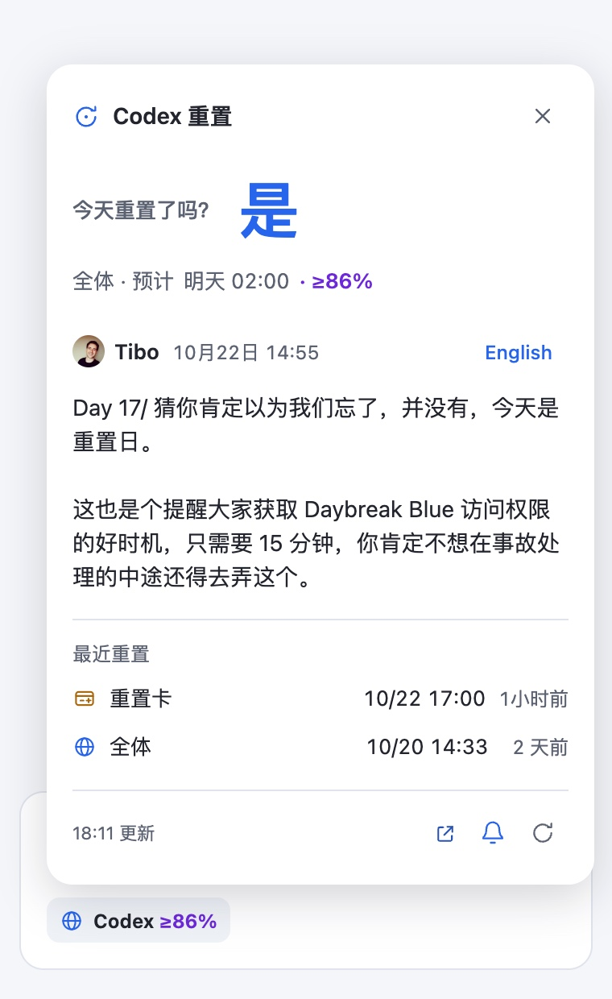
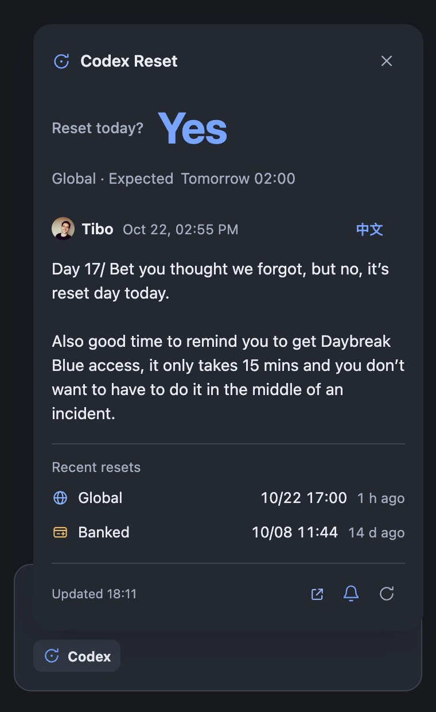

English | [简体中文](README.zh-CN.md)

# dsh-codex-reset-tracker

DeepSeek Harness plugin for Codex reset status. It adds a composer entry with a compact status popover and registers the read-only `codex_reset` agent tool.

## Acknowledgements

Reset signals and available translations are provided by [Did Codex Reset](https://didcodexreset.com/zh/). Thank you to its maintainers for collecting and organizing these public reset signals and providing the [read-only API](https://didcodexreset.com/zh/api.html) and [OpenAPI specification](https://didcodexreset.com/openapi/v1/openapi.json). This repository is a DSH integration of that upstream work; the API does not include account-specific quota information.

Original reset announcements are from [Tibo Sottiaux (@thsottiaux)](https://x.com/thsottiaux).

## Screenshots

| Light theme | Dark theme |
|---|---|
| <a href="assets/screenshot-light.jpg"></a> | <a href="assets/screenshot-dark.jpg"></a> |

## What it shows

- The composer stays compact: `Codex ≥86%`. A blue globe identifies Global resets, an amber card identifies Banked resets, and joint events show both icons. Tooltips and accessible labels give the full type; unknown types use a question-mark icon.
- The popover answers “Reset today?” with a large Yes or No. If the status is unavailable, it shows a dash. The next forecast sits below the answer.
- Tibo’s post appears directly below the forecast. When a confirmed reset has no post of its own, the tracker can show a recent announcement linked to that reset by the source. The post shows when it was published; the history shows when the reset was completed. One button switches the post to the other language when both are available. The post starts in the interface language when available, and the choice persists when reopening the popover during this page session. Switching sends no extra API request. The latest Global and Banked resets appear beneath the post, newest first, followed by the footer with fetch time and icon actions.
- Completion priority remains type-aware: a Banked completion does not hide a pending Global forecast, and joint schedules need both types completed. Confidence comes directly from the API; the dock retains its rounded 80% threshold while the popover can show lower probabilities.
- Refreshes run every 10 minutes, with 60-second freshness checks on opening, foregrounding or reconnecting. Timeout, rate-limit, retry and error fallback behavior remains. Completion notifications name the type, deduplicate joint events, and can notify sequential events on the same day; first-load silence, browser permission via the bell, Web Locks and recent-ID deduplication remain.

## Install from source

Clone the repository, then add it to a DSH profile:

```sh
git clone https://github.com/loshanvren/dsh-codex-reset-tracker.git
cd dsh-codex-reset-tracker
dsh plugin --profile <profile> add .
```

The package and client loader are named `dsh-codex-reset-tracker` as of v0.4.0.

### Upgrade from v0.3.x

The old package was named `dsh-codex-reset`. Remove that package from the same DSH profile before installing the new package, so the old tool and composer entry do not remain enabled alongside the new ones:

```sh
dsh plugin --profile <profile> remove dsh-codex-reset
dsh plugin --profile <profile> add https://github.com/loshanvren/dsh-codex-reset-tracker/releases/latest/download/dsh-codex-reset-tracker.tgz
```

Restart DSH after replacing the package. If you applied the patch manually, change its package `name` to `dsh-codex-reset-tracker`, preserve the `codex-reset` row ID and your `config`, and do not keep a second old row.

### Prebuilt install

```sh
dsh plugin --profile <profile> add https://github.com/loshanvren/dsh-codex-reset-tracker/releases/latest/download/dsh-codex-reset-tracker.tgz
```

The release tarball contains the same JavaScript, manifest, patch and locale files as a source install; there is no install-time build script.

## Agent tool

`codex_reset` supports:

- `action: "status"` — the latest global and Banked reset signals and the next scheduled reset.
- `action: "records"` — one page of records, filtered by `kind`, `page`, and `pageSize`.

Every record carries `resetType`: `global` (global reset), `banked` (banked reset) or `global_and_banked` (one event covering both). `kind` (`reset_scheduled` / `reset_completed`) is a separate axis and never substitutes for a type. Missing or unknown values are rendered as unknown, not guessed.

The tool accepts an optional `lang` for record translations. Successful responses are cached for 60 seconds by default.

| Config | Default | Purpose |
|---|---:|---|
| `apiBaseUrl` | `https://didcodexreset.com/openapi/v1` | Public API base URL used by the agent tool |
| `cacheTtlSeconds` | `60` | Tool response cache, from 5 to 3600 seconds |
| `timeoutMs` | `20000` | Tool call timeout, from 1000 to 120000 milliseconds |

Override these values under the plugin row's `config` in `cordis.patch.yml`. The public API documents a shared limit of 60 requests per hour per IP.

## License

The MIT License applies to this repository's code only. It does not relicense Did Codex Reset's data or translations, or Tibo Sottiaux's post and profile image.
