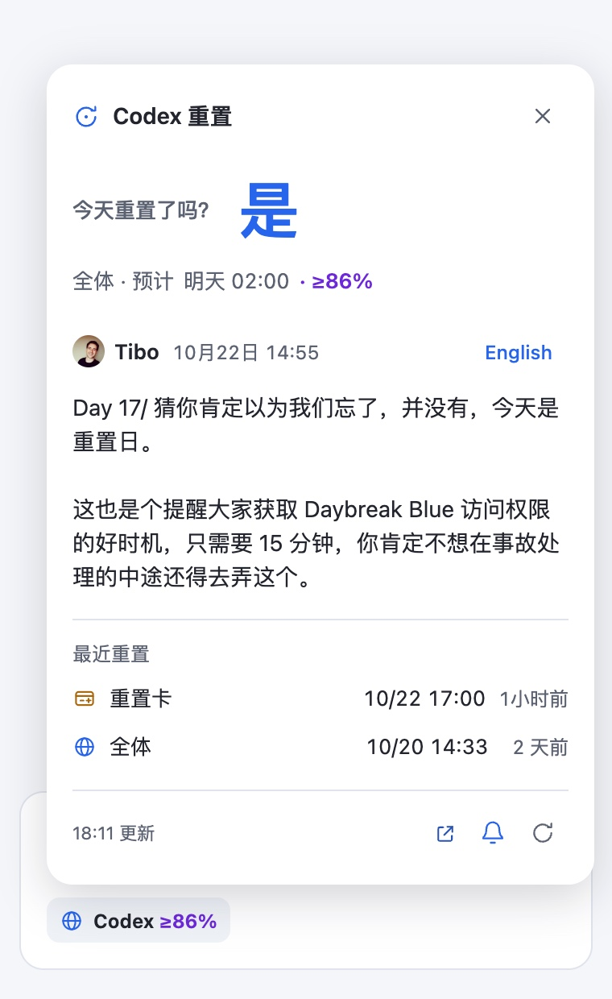
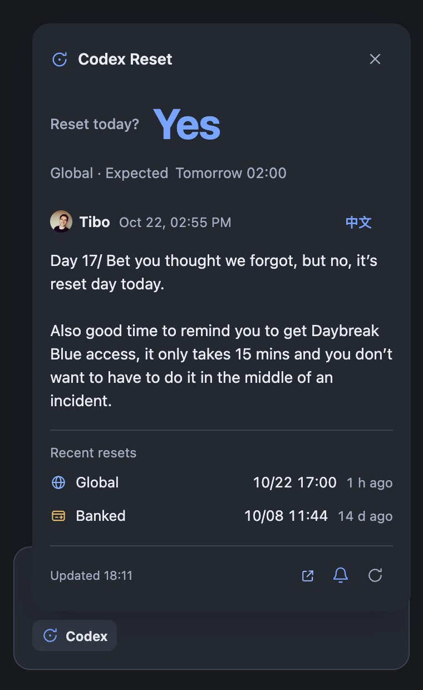

[English](README.md) | 简体中文

# dsh-codex-reset-tracker

DeepSeek Harness 的 Codex 重置状态插件。它在 composer 输入区添加一个入口，打开后显示简洁的状态浮层，并注册只读智能体工具 `codex_reset`。

## 致谢

重置信号和可用译文由 [Did Codex Reset](https://didcodexreset.com/zh/) 提供。感谢其维护者收集和整理这些公开重置信号，并提供[只读 API](https://didcodexreset.com/zh/api.html) 和 [OpenAPI 规范](https://didcodexreset.com/openapi/v1/openapi.json)。本仓库将这些上游工作集成到 DSH；该 API 不包含特定账号的配额信息。

原始重置公告来自 [Tibo Sottiaux (@thsottiaux)](https://x.com/thsottiaux)。

## 截图

| 浅色主题 | 深色主题 |
|---|---|
| <a href="assets/screenshot-light.jpg"></a> | <a href="assets/screenshot-dark.jpg"></a> |

## 显示内容

- composer 入口保持为简短的 `Codex ≥86%`。蓝色地球表示全体重置，琥珀色卡片表示重置卡，联合类型并排显示两个图标；悬停或屏幕阅读器可读取完整类型。未知类型使用问号图标，不凭颜色推断。
- 浮层顶部用大字「是」或「否」回答「今天重置了吗？」。无法确认时显示「—」。下一次预计重置显示在答案下方。
- 排期下方直接展示 Tibo 推文。中英文均可用时，点一次语言按钮就能切换正文。默认跟随界面语言，本次页面内关闭重开浮层会保留选择，切换无需新增 API 请求。最近重置放在推文下方，按完成时间从近到远排列。底栏显示获取时间和图标操作。
- 判断仍按类型隔离：今天发放重置卡不会隐藏全体重置预测，反之亦然；联合排期要两类都完成才被完成结论替代。概率来自 API，不制造置信度；入口保留四舍五入后 80% 的显示阈值，浮层可显示更低概率。
- 客户端每 10 分钟刷新，打开浮层、恢复前台或网络时按 60 秒新鲜度检查；保留超时、限流、失败回退与重试。完成通知写明类型，联合事件去重，同日先后完成两类分别提醒；首次快照静默，通知仍须点击铃铛后由浏览器授权，Web Locks 和近期 ID 保留跨页面去重。

## 从源码安装

克隆仓库，然后将其添加到 DSH 配置档案：

```sh
git clone https://github.com/loshanvren/dsh-codex-reset-tracker.git
cd dsh-codex-reset-tracker
dsh plugin --profile <profile> add .
```

自 v0.4.0 起，安装包和客户端加载器名称均为 `dsh-codex-reset-tracker`。

### 从 v0.3.x 升级

旧包名为 `dsh-codex-reset`。请先从同一个 DSH 配置档案移除旧包，再安装新包，避免旧工具和 composer 入口同时启用：

```sh
dsh plugin --profile <profile> remove dsh-codex-reset
dsh plugin --profile <profile> add https://github.com/loshanvren/dsh-codex-reset-tracker/releases/latest/download/dsh-codex-reset-tracker.tgz
```

替换后重启 DSH。如果曾手工应用安装补丁，请将包 `name` 改为 `dsh-codex-reset-tracker`，保留 `codex-reset` 行 ID 及原有 `config`，不要保留第二条旧插件记录。

### 预构建安装

```sh
dsh plugin --profile <profile> add https://github.com/loshanvren/dsh-codex-reset-tracker/releases/latest/download/dsh-codex-reset-tracker.tgz
```

发布包包含与源码安装相同的 JavaScript、清单、补丁及语言文件，无需安装期构建。

## 智能体工具

`codex_reset` 支持：

- `action: "status"` — 返回最新的全局重置与重置卡（Banked）信号，以及下次排期的重置。
- `action: "records"` — 返回一页记录，可按 `kind`、`page` 和 `pageSize` 筛选。

每条记录都带 `resetType`：`global`（全体重置）、`banked`（重置卡）或 `global_and_banked`（一条覆盖两类的事件）。`kind`（`reset_scheduled` / `reset_completed`）是另一条轴，不能当作类型使用。缺失或未知的值按未知呈现，不做臆测。

工具接受可选的 `lang` 参数，用于获取记录译文。成功响应默认缓存 60 秒。

| 配置项 | 默认值 | 用途 |
|---|---:|---|
| `apiBaseUrl` | `https://didcodexreset.com/openapi/v1` | 智能体工具使用的公开 API 基础 URL |
| `cacheTtlSeconds` | `60` | 工具响应缓存时间，可设为 5 到 3600 秒 |
| `timeoutMs` | `20000` | 工具调用超时时间，可设为 1000 到 120000 毫秒 |

可在 `cordis.patch.yml` 对应插件条目的 `config` 下覆盖这些值。公开 API 文档说明，共享限额为每个 IP 每小时 60 次请求。

## 许可证

本仓库代码适用 MIT 许可证。该许可证不对 Did Codex Reset 的数据或译文，以及 Tibo Sottiaux 的帖子和个人资料图片重新授权。
